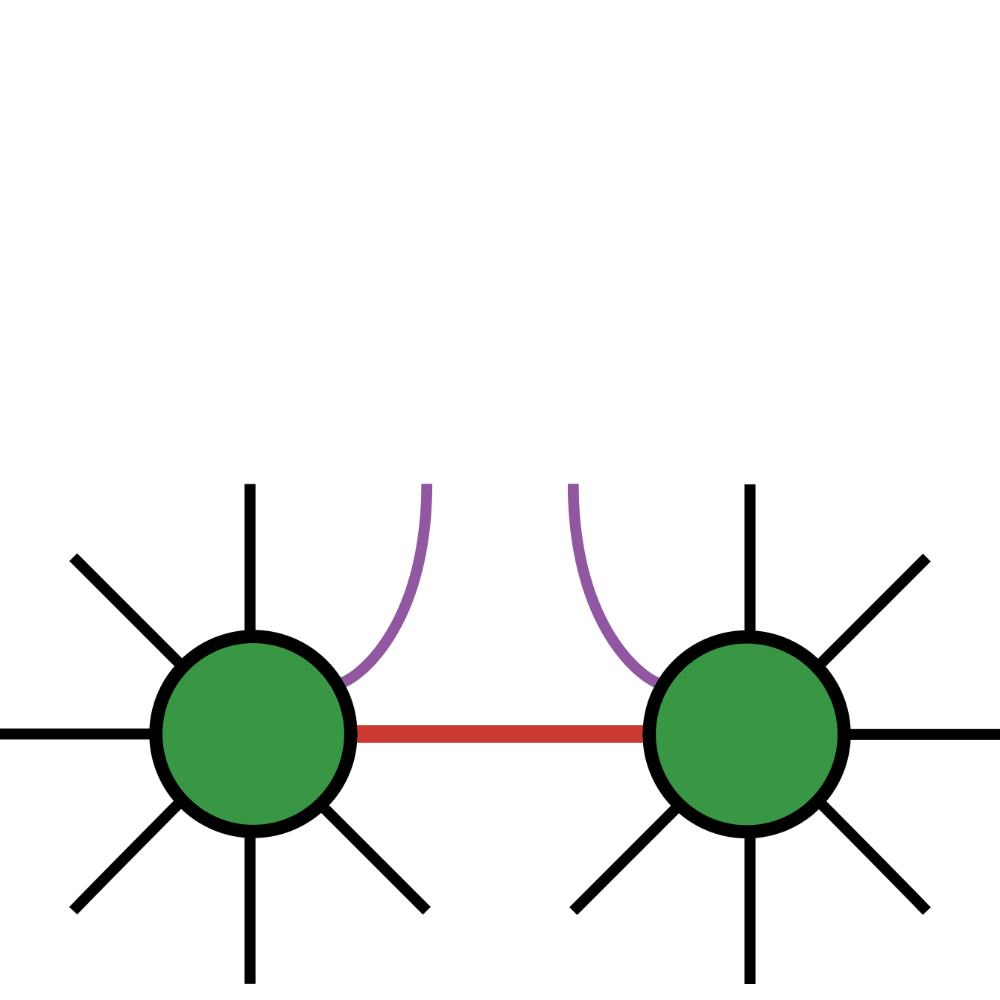

<div align="center">
  <br>
  
  <br>
  <strong>Disentanglers.jl</strong>
</div>


Julia package with a collection of tools to optimize tensor network representations. The central theme is to optimize representational entropy which might in some cases lead to compressed representations but compression is not always guaranteed. We build on ITensors.jl and integrate various solvers from Manopt.jl (manifold optimization) leading to Riemannian manifold based disentanglers, tensor sketching based disentanglers and environment based disentanglers. The package provides routines that profile the performance of these methods. Furthermore, the applications include circuit compilation for Matrix Product State (MPS), Matrix Product Operator (MPO) and optimizing the representation of Locally Purified Density Operators (LPDOs).


## Installation

- Clone the package

```
git clone https://github.com/amitjamadagni/Disentanglers.jl.git
```

- Install Disentanglers.jl via the Julia REPL:
```julia
julia> using Pkg
julia> Pkg.add("path/to/Disentanglers.jl");
```
or
```julia
julia> ] add path/to/Disentanglers.jl
```


## Dependencies

The package is built on the following packages
- [ITensors.jl](https://github.com/ITensor/ITensors.jl),
- [ITensorMPS.jl](https://github.com/ITensor/ITensorMPS.jl),
- [Manifolds.jl](https://github.com/JuliaManifolds/Manifolds.jl),
- [Manopt.jl](https://github.com/JuliaManifolds/Manopt.jl),
- [DifferentiationInterface.jl](https://github.com/JuliaDiff/DifferentiationInterface.jl) (mainly [Zygote.jl](https://github.com/FluxML/Zygote.jl)),
- [TensorSketch](https://github.com/kjslag/fastDisentangle/blob/main/fastDisentangle.jl),
- [Documenter.jl](https://github.com/juliadocs/documenter.jl) (for documentation),
- [Runic.jl](https://github.com/fredrikekre/Runic.jl) (for code formatting).

The disentangling algorithms are designed to return `ITensor` data structures to better integrate into the Julia ecosystem, however the internals are completely pure Julia multi-dimensional arrays.

## Examples

We employ the various disentangler algorithms to disentangle various tensor network representations (refer to `Examples` section in the documentation):
- Matrix Product State (MPS) representations, see Disentangling Matrix Product States
- Matrix Product Operator (MPO) representations, see Unitary Compression
- Locally Purified Density Operator (LPDO) representations, see Optimizing the representation of LPDO

These represent a sample and can be extended to other scenarios, or other representations that allow isometric representational optimization.

## Documentation

Documentation can be accessed by cloning the `gh-pages` branch.

```
git clone -b gh-pages https://github.com/amitjamadagni/Disentanglers.jl.git
```

Once cloned, the documentation can be accessed by opening the `Disentanglers.jl/index.html` file in the browser.

## Profiling the performance of disentanglers

Functions to profile the different disentangling algorithms are outlined in the `Profiling disentanglers` section in the documentation.

## Enabling GPU compute

`GPU integration` section in the documentation outlines a procedure that enables computing on GPUs.

## AI usage

AI agents weren't put to use to generate any code, this is in order to retain and experience the process of learning, writing code and building software packages! However, AI was used to generate docstrings, the authors have verified the generated docstrings and have mostly modified them!

## Authors

- Amit Jamadagni (gangapurama@ornl.gov)
- Eugene Dumitrescu (dumitrescuef@ornl.gov)

## Acknowledgment

We acknowledge the support by the U.S. Department of Energy, Office of Science, Advanced Scientific Research Program, Early Career Award under contract number ERKJ420. We thank Bo Xiao, Nathan Johnson, George Arapantonis, Varadharajan Muruganandam for insightful discussions.
