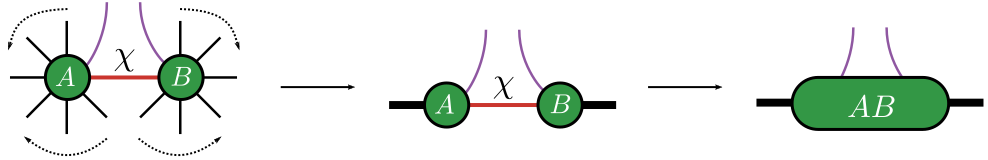
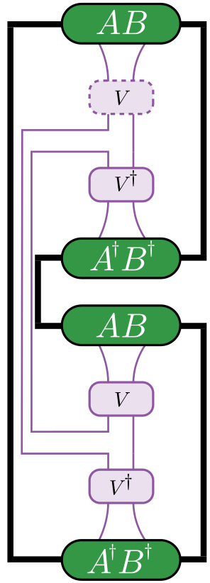
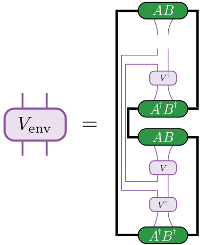
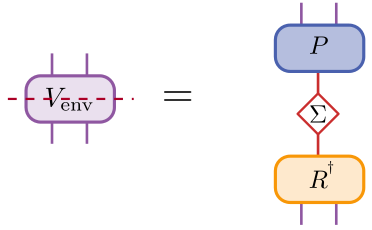

# [Evenbly-Vidal](@id EvenblyVidal)
We present Evenbly Vidal algorithm implemented in `Disentanglers.jl`

The key idea is to disentangle the representation of a tensor network employing environment based Evenbly-Vidal algorithm.

```@raw html
<div style="text-align: center;">
    
</div>
&nbsp;
```
Figure: The indices on which the isometry acts are marked in purple. The package requires mentioning the indices on which the isometry acts with the left neighbors and right neighbors passed as an array. The package internally translates the left and right neighbors into a single combined index.


Central to the disentangler algorithm is constructing an the environment surrounding the isometry that needs to be updated. That is, we contract the entire tensor network by assuming the isometry that needs an update to be absent. We then perform a SVD on the environment tensor and construct the isometry from the SVD matrices. In the current scenario, we find isometries that minimize the second-Rényi entropy defined as in the following figure
```@raw html
<div style="text-align: center;">
    
</div>
&nbsp;
```
Figure: Find isometry, ``V``, such that the second-Rényi entropy, ``-\log(\operatorname{Tr}(\rho^{2}))`` is minimized. ``\operatorname{Tr}(\rho^{2})`` is computed using the non-trivial contraction.

We then construct the environment around the isometry ``V`` as in the following figure
```@raw html
<div style="text-align: center;">
    
</div>
&nbsp;
```
Figure: The construction of the environment by contracting the tensor network except the isometry that needs to be updated.


We then perform a SVD on the environment tensor to arrive at the updated isometry that reduces the second-Rényi entropy. In case the isometry, ``V`` is strictly unitary, other combinations of ``P (P^{\dag})`` and ``R (R^{\dag})`` remain unitary and therefore also are valid updates. Among these combinations, we notice that ``P^{\dag}R`` reduces the second-Rényi entropy.
```@raw html
<div style="text-align: center;">
    
</div>
&nbsp;
```
Figure: SVD on the environment tensor leading to the construction of the updated isometry.

The package offers implementations with the ITensor data structure and a pure Julia implementation independent of the above data structure. The related documentation are at:
- EV pure Julia implementation, see [`Disentanglers.isometry_ev`](@ref Disentanglers.isometry_ev)
- EV `ITensor` data structure based implementation (this is a bit slower due to the metadata stored by the `ITensor` data structure), see [`Disentanglers.isometry_ev_it`](@ref Disentanglers.isometry_ev_it)
- For comparing the different combinations, see [`Disentanglers.isometry_ev_mat_env_tensor`](@ref Disentanglers.isometry_ev_mat_env_tensor), [`Disentanglers.isometry_ev_mat_compare_combs`](@ref Disentanglers.isometry_ev_mat_compare_combs)
