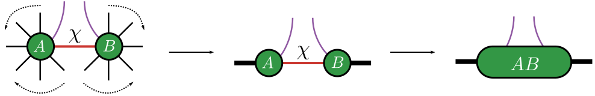
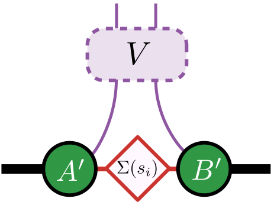
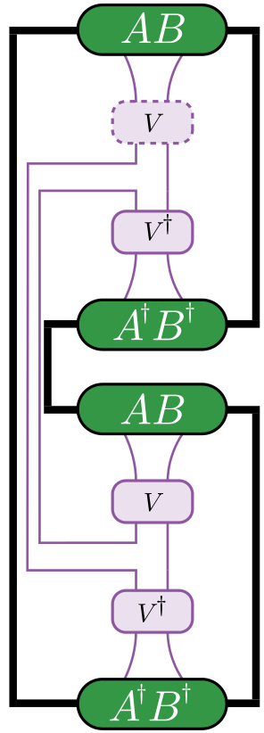

# [Riemannian Disentanglers](@id RiemannianDisentanglers)
We present Riemannian manifold based disentangling algorithms. The disentangling algorithms integrate differential geometry features from packages
[Manifolds.jl](https://github.com/JuliaManifolds/Manifolds.jl), [Manopt.jl](https://github.com/JuliaManifolds/Manopt.jl), gradients from
[DifferentiationInterface.jl](https://github.com/JuliaDiff/DifferentiationInterface.jl) and tensor operations from [ITensors.jl](https://github.com/ITensor/ITensors.jl),
[ITensorMPS.jl](https://github.com/ITensor/ITensorMPS.jl).

The key idea is to disentangle the representation of a tensor network employing manifold based optimization techniques.

```@raw html
<div style="text-align: center;">
    
</div>
&nbsp;
```
Figure: The indices on which the isometry acts are marked in purple. The package requires mentioning the indices on which the isometry acts with the left neighbors and right neighbors passed as an array. The package internally translates the left and right neighbors into a single combined index. Then we find the isometry that minimizes the objective function which we define below.

### Manifold based optimization

Riemannian manifold optimization techniques generally involve the following:

1: Choose a manifold, ``\mathcal{M}`` (here Unitary/Stiefel/Grassmannian)

2: Define an objective function, ``f_\text{opt}(V)``, parameterized by ``V \in \mathcal{M}`` that returns a real number

3: If gradients are required, define the gradient of the objective function ``\nabla f_\text{opt}(V)`` (numerical derivative computed using an engine from [DifferentiationInterface.jl](https://github.com/JuliaDiff/DifferentiationInterface.jl), we default to [Zygote.jl](https://github.com/FluxML/Zygote.jl)

4: Initialize a random point (here isometry), ``V_\text{init} \in \mathcal{M}``

5: Select a solver from [Manopt.jl](https://github.com/JuliaManifolds/Manopt.jl) with ``f_\text{opt}(V)$, $\nabla f_\text{opt}(V)`` and ``V_\text{init}`` (random initialization on the manifold) as the parameters

6: The solver returns a point (here isometry) that optimizes the objective function

```@raw html
<div style="line-height: 150%;">&nbsp;</div>
```

### Different objective functions

We now describe the different objective functions defined in the package. For example implementations, see: [`Disentangling the MPS`](@ref DisentanglingMPS), [`Compressing the MPO`](@ref DisentanglingMPO), [`Optimizing the LPDO`](@ref DisentanglingLPDO).

#### Entropy based objective functions

##### α-Rényi entropy calculation

We find ``V \in \mathcal{M}`` such that the α-Rényi entropy associated with the singular values, ``s_{i}`` of the virtual index is minimized.
The α-Rényi entropy is defined as
``
S^{\alpha}_{\text{ent}} = \frac{1}{1-\alpha}\log(\sum_{i}s_{i}^{2\alpha})
``

```@raw html
<div style="text-align: center;">
    
</div>
&nbsp;
```
Figure: Find isometry, ``V``,  such that the α-Rényi entropy associated with the singular values, ``s_{i}``, ``S^{\alpha}_{\text{ent}}`` is minimized.

The documentation for:
- α-Rényi entropy, see [`Disentanglers.alpha_renyi_entropy`](@ref alpha_renyi_entropy)
- Numerical gradient of α-Rényi entropy, see [`Disentanglers.grad_mat_are`](@ref Disentanglers.grad_mat_are)
- Function integrating the above while returning the optimal isometry, see [`Disentanglers.isometry_ro_are`](@ref isometry_ro_are)

##### Second-Rényi entropy

We find ``U \in \mathcal{M}`` such that the second-Rényi entropy defined as in the following figure is minimized.
!!! warning
    This computation of the objective function using such a contraction requires the norm to be 1. (Generally MPO like structures fail with this kind of approach).

```@raw html
<div style="text-align: center;">
    
</div>
&nbsp;
```
Figure: Find isometry, ``V``, such that the second-Rényi entropy, ``-\log(\operatorname{Tr}(\rho^{2}))`` is minimized. ``\operatorname{Tr}(\rho^{2})`` is computed using the non-trivial contraction.


The documentation for:
- Second-Rényi entropy, see [`Disentanglers.second_renyi_entropy`](@ref second_renyi_entropy)
- Numerical gradient of second-Rényi entropy, see [`Disentanglers.grad_mat_sre`](@ref Disentanglers.grad_mat_sre)
- Function integrating the above while returning the optimal isometry, see [`Disentanglers.isometry_ro_sre`](@ref isometry_ro_sre)


#### Distance based objective functions

##### Normalized Frobenius Norm

In the context of compressing MPO representation of unitaries, we can employ distance based objective functions given by the Normalized Frobenius Norm:

``
\mathcal{\tilde{F}}(U_\text{ref}, W) = 1 - \frac{1}{d}\text{Re}(Tr[U_\text{ref}^{\dag}W])
``

The optimization problem then reduces to finding the isometry `W` that reduces the above measure.

The documentation for:
- Normalized Frobenius Norm, see [`Disentanglers.unitary_overlap`](@ref unitary_overlap)
- Numerical gradient of Normalized Frobenius Norm, see [`Disentanglers.grad_mat_uo`](@ref Disentanglers.grad_mat_uo)
- Function integrating the above while returning the optimal isometry, see [`Disentanglers.isometry_unitary_overlap`](@ref isometry_unitary_overlap)


See related API function calls at [Riemannian based disentanglers](@ref RbD).
