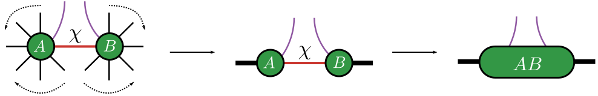

# [Tensor Sketch](@id TensorSketch)
We present Tensor Sketch algorithm as implemented in the reference.

The key idea is to disentangle the representation of a tensor network employing the tensor sketch algorithm.

```@raw html
<div style="text-align: center;">
    
</div>
&nbsp;
```
Figure: The indices on which the isometry acts are marked in purple. The package requires mentioning the indices on which the isometry acts with the left neighbors and right neighbors passed as an array. The package internally translates the left and right neighbors into a single combined index.
