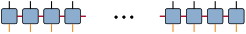
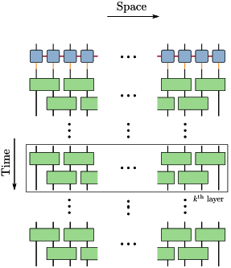

# [Optimizing the representation of LPDO](@id DisentanglingLPDO)

Locally Purified Density Operators (LPDOs) are one among many candidates that efficiently represent mixed quantum states. In addition to the coherent correlations encoded in the virtual χ-index, LPDOs encode mixture correlations in the κ-index. The equivalent density matrix is obtained by contracting the virtual κ-indices and thus isometries in the κ-space leave the LPDO representation invariant.

```@raw html
<div style="text-align: center;">
    
    <p>Figure: Locally Purified Density Operators (LPDOs) are efficient at representing mixed states. The virtual κ-indices (denoted by orange) encode the mixture correlations, while the virtual χ-indices (denoted by red) encode the coherent correlations. Contracting over the κ-indices leads to the mixed state ρ, therefore the isometries in the κ-space leave ρ invariant.  </p>
</div>
&nbsp;
```

In the current example, we consider a maximally mixed state obtained by the action of noise channels on an initial random pure state. That is, we consider an initial pure state acted upon by noise channels for a finite amount of time that finally results in a maximally mixed state. This is the scenario in all of the current day quantum architectures wherein any state converges to a maximally mixed state in the long time limit. We observe that the action of the noise channels on a random pure state results in a maximally mixed state whose LPDO representation remains sub-optimal. This is due to the fact that the single-body noise channels just interact with the κ-subspaces with no control on the χ-subspace, thus leading to a maximally mixed state whose representation is sub-optimal. However, we know that the optimal representation of the maximally mixed state has χ=1. Thus, our optimization techniques can be applied in the κ-subspace to prune the coherent χ-correlations to 1. In the MPS setting, setting a high cutoff while pruning results in loss of dominant correlations leading to high infidelity of the pruned state with the original state. In the case of the LPDO, we observe that the sub-optimal representation can be effectively pruned using a high-cutoff while maintaining high-fidelity with respect to the initial sub-optimally represented LPDO. The interplay of the optimizers and the choice of the cutoff has been explored in [1].

[1] Locally purified maximally mixed states at scale: Entanglement pruning and symmetries, Journal of Mathematical Physics 67, 072201 (2026).

```@raw html
<div style="text-align: center;">
    
    <p>Figure: Brickwall layered unitary circuit to optimize the representation of LPDO. Isometries in the κ-space (representing the mixture correlated) are used to prune the spurious correlations in χ-space </p>
</div>
&nbsp;
```

The example snippet employs Riemannian based disentanglers with entropy based objective functions to map the sub-optimal representation to its optimal counterpart: [`Disentanglers.benchmark_lpdo_opt`](@ref Disentanglers.benchmark_lpdo_opt)

```@docs
Disentanglers.benchmark_lpdo_opt
```
