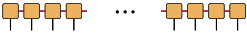
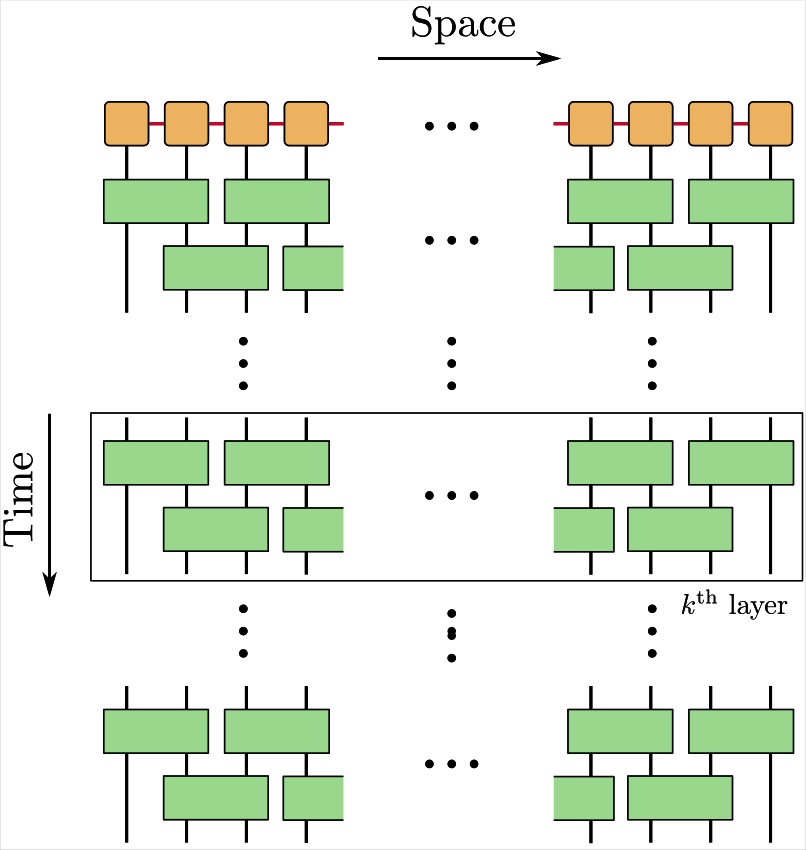

# [Disentangling Matrix Product States](@id DisentanglingMPS)

We present an example of disentangling Matrix Product States (MPS). MPS efficiently encode the entanglement in quantum states, thereby allowing for representation of quantum states at scale.

```@raw html
<div style="text-align: center;">
    
    <p>Figure: Matrix Product States (MPSs) are low-rank approximation of quantum states with physical indices (denoted by black) and coherent correlations encoded by the χ-virtual indices (denoted by red).</p>
</div>
&nbsp;
```

The idea is to employ the different solvers and sequentially disentangle the MPS (obtained from DMRG or other sources). This results in a brickwall layered dientangling unitary circuit. The daggered version of the disentangling circuit is the state preparation circuit or the compiling circuit for the given MPS.


```@raw html
<div style="text-align: center;">
    
    <p>Figure: Brickwall layered unitary circuit to disentangle MPS </p>
</div>
&nbsp;
```

### Wrapper to access different algorithms

A unified function call for disentangling a given MPS is at [`Disentanglers.benchmark_mps_opt`](@ref Disentanglers.benchmark_mps_opt).

```@docs
Disentanglers.benchmark_mps_opt
```

### Specific disentangler algorithms

Specialized calls for using a particular disentangling algorithm:


- Riemannian disentanglers with α-Rényi entropy as the objective function: [`Disentanglers.benchmark_ro_are_opt`](@ref Disentanglers.benchmark_ro_are_opt)

```@docs
Disentanglers.benchmark_ro_are_opt
```

- Riemannian disentanglers with second-Rényi entropy as the objective function: [`Disentanglers.benchmark_ro_sre_opt`](@ref Disentanglers.benchmark_ro_sre_opt)

```@docs
Disentanglers.benchmark_ro_sre_opt
```

- Tensor sketching disentangler: [`Disentanglers.benchmark_ts_opt`](@ref Disentanglers.benchmark_ts_opt)

```@docs
Disentanglers.benchmark_ts_opt
```

- Evenbly-Vidal disentangler: [`Disentanglers.benchmark_ev_opt`](@ref Disentanglers.benchmark_ev_opt)

```@docs
Disentanglers.benchmark_ev_opt
```
