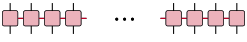
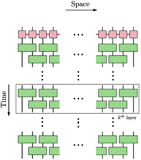

# [Unitary Compression](@id DisentanglingMPO)

We present an example of disentangling an MPO. The dynamics of a quantum system can be approximated using an MPO (for instance: Trotter dynamics associated with Hamiltonian evolution).

```@raw html
<div style="text-align: center;">
    
    <p>Figure: Matrix Product Operators (MPOs) represent quantum operators with physical indices (denoted by black) and coherent correlations encoded by the χ-virtual indices (denoted by red).</p>
</div>
&nbsp;
```

### Entropy based objective function

Such an MPO can be further compressed by disentangling it. Here we employ the entropy based objective function to disentangle and due to the non-unity of the norm in the MPO we restrict the scope of disentanglers to be a Riemannian disentangler with α-Rényi entropy as the objective function.

```@raw html
<div style="text-align: center;">
    
    <p>Figure: Brickwall layered unitary circuit to disentangle MPO (Update figure) </p>
</div>
&nbsp;
```

Riemannian disentanglers with α-Rényi entropy as the objective function: [`Disentanglers.benchmark_mpo_disentangler_opt`](@ref Disentanglers.benchmark_mpo_disentangler_opt)

```@docs
Disentanglers.benchmark_mpo_disentangler_opt
```

### Distance based objective function

MPOs can also be disentangled using distance based objective functions, like Normalized Frobenius Norm. That is, we couple the brickwall layered Riemannian disentanglers (as above) with the distance based objective function. For each application of the isometry we apply the isometry and minimize the associated trace norm of the updated MPO.

Riemannian disentanglers with normalized Frobenius norm as the objective function: [`Disentanglers.benchmark_mpo_distance_measure_opt`](@ref Disentanglers.benchmark_mpo_distance_measure_opt)

```@docs
Disentanglers.benchmark_mpo_distance_measure_opt
```
